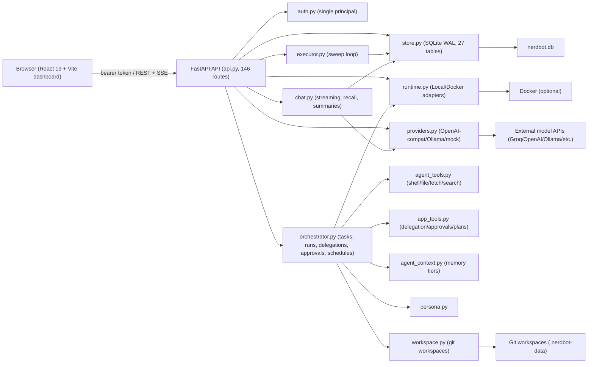

# Nerdbot — Full Codebase Audit & Product Readiness Assessment

**Date:** 2026-11-06
**Scope:** Entire repository at commit `726844d` (plus uncommitted working-tree changes in dashboard). Inspection only — no source modified by this audit.

---

## REPORT 1 — Executive Summary

### What Nerdbot currently is
Nerdbot is a **self-hosted, single-owner personal AI workspace** built as a **FastAPI backend (Python 3.12) + React/Vite dashboard** served from the same process, with all state in **SQLite (WAL mode)**. It is *not* a SaaS or multi-user product. The README positions it as "Chat-first personal AI workspace" and that positioning is accurate for what has actually been built.

### What it can actually do today
- **Conversation:** Streaming/non-streaming chat per thread, per-thread model switching, file attachments, thread summaries recalled across threads, objective → plan preview.
- **Teammates (bots):** Persistent identity (persona, instructions, provider, permissions, memory scope, face), CRUD, disable/archive, memory read/write, task ownership.
- **Tasks & execution:** Create tasks, run them (async + sync), retry, cancel, live SSE event stream with polling fallback, isolated Git workspaces per task, artifacts, patches, PR packages (generated locally, never pushed), reviews, delegation tree.
- **Approvals:** Fail-closed, backend-enforced, 3 decisions (reject / approve-once / approve-forever), one inbox across workspaces, approval that *executes* the gated action.
- **Providers:** OpenAI-compatible, Ollama, mock; Fernet-encrypted keys at rest; health check + model catalog; BYOK env-var reference.
- **Memory/knowledge:** Conversation + thread summaries, project/teammate memory tiers, offline overlap-based RAG (no vectors), knowledge attach to tasks.
- **Integrations:** DuckDuckGo Lite web search, SSRF-guarded URL fetch, GitHub read-only issue fetch + preview-then-ingest, webhook out (allowlisted HTTPS), inbound webhook ingestion, cron schedules, notifications (persisted, no external send), backup/restore.
- **Execution environment:** Local shell (guardrailed) + Docker runtime adapter; process-group cancellation; run recovery on restart.
- **UI:** React 19 dashboard with project detail (primary tabs Chat/Tasks/Teammates/Providers + Advanced dropdown), bots, boards, teams, workbench, approvals, settings, terminal (xterm).

### Strongest existing capabilities
1. **Agent execution loop** with real tool use (shell, file read/write, fetch_url, web_search, remember, update_persona), permission gating, and SSE live events.
2. **Approval workflow** that actually executes the gated action on approval (not just a record).
3. **Workspace isolation** — per-task Git workspaces with diff/patch/PR-package generation.
4. **Provider abstraction** — genuinely interchangeable (OpenAI-compatible + Ollama + mock), with health checks and model catalog.
5. **Test coverage** — 479 backend pytest (all passing) + 152 frontend vitest + playwright E2E.

### Biggest limitations
1. **Single principal only** — `PRINCIPAL = "local-owner"`, no users/accounts/sessions beyond one bearer token.
2. **No browser automation, no email/Slack send, no MCP** — explicitly rejected/deferred in capabilities.
3. **No vector/embedding memory** — overlap scoring only (intentional, documented).
4. **No GitHub write/push** — PR packages are local artifacts only.
5. **UI is dense** — 15 project tabs, many surfaces; chat is now default but still competes with machinery.
6. **No external agent adapters** — only in-process teammates.
7. **Agent delegation is in-process** — no distributed workers; long tasks bounded by `NERDBOT_RUN_TIMEOUT_S` (default 60s).

### How far from the intended product
Roughly **60–70% of a working single-user product**, **~20% of the multi-user/SaaS vision**. Core chat + agent execution + approvals genuinely work. Multi-user, browser automation, email/Slack, GitHub push, vectors, and a polished unified UX are missing or deferred.

---

## REPORT 2 — Existing Architecture

**Components that exist but are partial/stubbed:** browser automation (rejected), email/Slack (stub), MCP (none), external agent adapters (stub), vector memory (rejected), GitHub write (local package only), multi-user (none).

---

## REPORT 3 — Feature Inventory

| Feature | Current implementation | Status | Evidence | Remaining work |
|---|---|---|---|---|
| Chat (streaming) | `api.py` `/threads/{id}/chat/stream` SSE; `chat.py` `chat_stream`; dashboard `sendChatStream` | Fully implemented & verified | `tests/test_chat.py`, dashboard `views-chat.tsx` | None core |
| Chat (non-streaming) | `/threads/{id}/chat` | Fully implemented | `tests/test_chat.py` | None |
| Thread history/summaries | `chat_threads`, `chat_messages`, `summarize_thread`, recalled context | Fully implemented | `store.py`, `chat.py` | None |
| Model switching per thread | `updateThread` provider_id | Fully implemented | `views-chat.tsx` | None |
| File attachments in chat | FileReader → content appended | Fully implemented | `views-chat.tsx` | None |
| Task creation from chat | `createObjective`, `createTask` | Fully implemented | `views-chat.tsx` | None |
| Teambot CRUD | `api.py` teammates endpoints; `store.py` | Fully implemented | `tests/test_teammates*.py` | None |
| Bot memory (tiers) | `agent_context.py`, `teammateMemory` | Fully implemented | `tests/test_memory*.py` | Vector search not implemented (intentional) |
| Bot persona (soul/goals/wisdom) | `persona.py`, `getPersona` | Fully implemented | `tests/test_persona.py` | None |
| Bot face/avatar | `faces.py`, dashboard `bot/` engine | Fully implemented | `tests/test_faces.py` | None |
| Task CRUD + status | `store.py` tasks, `api.py` | Fully implemented | `tests/test_tasks*.py` | None |
| Task run (sync) | `POST /tasks/{id}/runs` | Fully implemented | `tests/test_runs.py` | None |
| Task run (async) | `POST /tasks/{id}/runs/async` + executor sweep | Fully implemented | `tests/test_executor*.py` | None |
| Run events (SSE) | `GET /runs/{id}/events/stream` | Fully implemented | `tests/test_run_events.py` | None |
| Run cancel | `POST /runs/{id}/cancel`, process group | Fully implemented | `tests/test_cancel*.py` | None |
| Retry (new run) | `POST /tasks/{id}/retry` | Fully implemented | `tests/test_retry.py` | None |
| Isolated workspaces | `workspace.py` `create_isolated_workspace` | Fully implemented | `tests/test_workspace*.py` | None |
| Workspace diff/patch | `workspace_diff`, `capturePatch` | Fully implemented | `tests/test_patch*.py` | None |
| PR package (local) | `generate_pr_package` | Fully implemented (never pushes) | `tests/test_pr_package.py` | GitHub push not implemented |
| Reviews | `submit_review`, `latest_review` | Fully implemented | `tests/test_reviews.py` | None |
| Delegation | `delegation.py`, `delegate`, `respond` | Fully implemented | `tests/test_delegation*.py` | None |
| Approvals (fail-closed) | `gates.py`, `approval_flow.py`, `decide_approval` | Fully implemented | `tests/test_approval*.py` | None |
| Providers (OpenAI-compat) | `providers.py` `OpenAICompatibleAdapter` | Fully implemented | `tests/test_providers*.py` | None |
| Providers (Ollama) | `providers.py` | Fully implemented | `tests/test_providers*.py` | None |
| Providers (mock) | `MockRuntimeAdapter` | Fully implemented | `tests/test_mock*.py` | None |
| Provider health/models | `health_check`, `list_upstream_models` | Fully implemented | `tests/test_provider_health.py` | None |
| Secret encryption | `secrets.py` Fernet | Fully implemented | `tests/test_secrets.py` | None |
| Web search | `search.py` DuckDuckGo Lite | Fully implemented | `tests/test_search.py` | None |
| URL fetch (SSRF-guarded) | `fetch.py` | Fully implemented | `tests/test_fetch.py` | None |
| GitHub issue fetch | `integrations/github.py` | Fully implemented (read-only) | `tests/test_github*.py` | Write/push not implemented |
| Knowledge/RAG (overlap) | `knowledge.py` | Fully implemented (no vectors) | `tests/test_knowledge*.py` | Vectors intentionally rejected |
| Schedules (cron) | `schedules.py` | Fully implemented | `tests/test_schedules.py` | None |
| Notifications (persisted) | `notify.py` | Fully implemented (no external send) | `tests/test_notify*.py` | Email/Slack send stub |
| Webhook out | `notify.py` allowlisted HTTPS | Fully implemented | `tests/test_webhook*.py` | None |
| Inbound webhook | `ingest_inbound` | Fully implemented | `tests/test_ingress*.py` | None |
| Backup/restore | `backup.py` | Fully implemented | `tests/test_backup*.py` | None |
| Boards | `boards.py` | Fully implemented | `tests/test_boards*.py` | None |
| Teams | `teams` in store/api | Fully implemented | `tests/test_teams*.py` | None |
| Terminal (PTY) | `terminal.py` + xterm | Fully implemented | `tests/test_terminal*.py` | None |
| Auth (single token) | `auth.py` | Fully implemented (single principal) | `tests/test_auth*.py` | Multi-user not implemented |
| Docker runtime | `DockerRuntimeAdapter` | Fully implemented | `tests/test_docker*.py` | None |
| Chat UI (React) | `views-chat.tsx` | Fully implemented | dashboard tests | None |
| Project tabs UI | `views-project/index.tsx` | Fully implemented | none E2E | None |
| Bot UI | `views-bot.tsx` | Fully implemented | none | None |
| Approvals UI | `views-approvals.tsx` | Fully implemented | `approvals.test.ts` | None |
| Memory UI | `views-project/memory.tsx` | Fully implemented | none | None |
| Files UI | `views-project/files.tsx`, workbench | Fully implemented | `workbench.test.ts` | None |
| Settings UI | `views-settings.tsx` | Fully implemented | none | None |
| Browser automation | Capability `browser.automation` = rejected | Not implemented (rejected) | `capabilities.py` | Intentionally out of scope |
| Email/Slack send | Stubs | Stub | `capabilities.py` | Deferred |
| MCP support | None | Not implemented | — | Would be needed for tool ecosystem |
| Multi-user/auth accounts | None | Not implemented | — | Required for SaaS |
| Vector DB / embeddings | Rejected | Not implemented (intentional) | `capabilities.py` | Could revisit if corpus grows |
| GitHub push/PR creation | Local package only | Partial | `orchestrator.generate_pr_package` | Real push not implemented |
| External agent adapters | Stub | Not implemented | `capabilities.py` | Rejected until contract |
| Token rotation | Deferred | Not implemented | `capabilities.py` | Deferred |
| Postgres | Deferred | Not implemented (SQLite only) | `capabilities.py` | Migration path only |

---

## REPORT 4 — Product Gap Analysis (vs. vision)

| Vision item | Status | Gap |
|---|---|---|
| Central conversational assistant | ✅ Works | Chat is primary now (after recent changes). |
| Persistent memory across conversations/projects | ✅ Works (overlap RAG) | No vector/semantic search; memory is text-tiered. |
| Multiple specialised agents executing tasks | ✅ Works | In-process only; no distributed workers. |
| Central orchestrator delegating/combining | ✅ Works (CEO persona + delegation) | Delegation is in-process and bounded by run timeout. |
| Visual workspace for projects/agents/tasks/workflows/deliverables | ✅ Mostly works | Dense UI (15 tabs); recently collapsed to primary+advanced. |
| Agents with browser/terminal/files/external integrations | ⚠️ Partial | Terminal ✅, files ✅, fetch/search ✅, browser ❌, email/Slack ❌, GitHub read-only. |
| Multi-model (OpenAI/Anthropic/xAI/Google/local) | ⚠️ Partial | OpenAI-compatible + Ollama + mock. Anthropic/xAI/Google only if OpenAI-compatible endpoint. No native adapters. |
| Configurable autonomy + approvals for sensitive ops | ✅ Works | Strong. |
| Persistent agent sessions, monitor/pause/resume/stop | ⚠️ Partial | Monitor ✅ (SSE), stop ✅, pause/resume ❌ (cancel only; no pause). |
| Polished unified UI | ⚠️ Partial | Functional but dense; recent A-D improvements help. |
| Multi-user / isolated workspaces / permissions / SaaS | ❌ Not implemented | Single principal only. |

---

## REPORT 5 — Technical Debt

1. **Single-principal auth** (`auth.py` `PRINCIPAL = "local-owner"`) — entire data model assumes one owner; multi-user would require schema + permission refactor.
2. **No pause/resume** for runs — only cancel; long tasks can't be suspended.
3. **Run timeout default 60s** (`NERDBOT_RUN_TIMEOUT_S`) — slow providers fail; documented but fragile.
4. **Dense project UI** — 15 tabs (now primary+advanced dropdown) still a lot; many advanced surfaces rarely used.
5. **Duplicated empty-state patterns** — some actionable, some not; inconsistent.
6. **PR packages never push** — local artifact only; "PR" is misleading.
7. **Knowledge retrieval is token-overlap only** — no semantic search; acceptable per design decision but a ceiling.
8. **No vector/embedding support** — explicitly rejected; revisit if corpus grows.
9. **Frontend bundle size** — 946KB minified JS (single chunk); no code splitting.
10. **SQLite only** — acceptable for single user but a ceiling for SaaS; migration path deferred.
11. **No MCP** — tool ecosystem limited to built-in tools.
12. **Terminal PTY + Docker** — security surface; guardrails exist but shell execution is powerful.
13. **Dashboard served by backend** — requires separate `npm run build`; Dockerfile doesn't build dashboard (must pre-build). Deployment friction.
14. **Uncommitted working-tree changes** — several files modified in this session (views-chat, views-project/index, views-boards, views-project/messages, views-project/tasks, views-project/providers, views-bot) not yet committed.

---

## REPORT 6 — Product Readiness (scores /10)

| Area | Score | Reasoning |
|---|---:|---|
| Core chat experience | 8/10 | Streaming, markdown, attachments, model switching, summaries all work. Collapse of long output added. |
| Multi-agent orchestration | 7/10 | Delegation + CEO orchestrator work in-process; bounded by timeout; no distributed workers. |
| Agent execution | 8/10 | Real tool loop, SSE live events, cancel, retry, isolated workspaces, artifacts. |
| Workspace experience | 6/10 | Dense tabs; chat now default; workbench exists but heavy. |
| Memory | 6/10 | Text-tiered + overlap RAG; no semantic/vector; adequate for current scale. |
| Model flexibility | 7/10 | OpenAI-compat + Ollama + mock; no native Anthropic/xAI/Google adapters; health checks exist. |
| Security | 7/10 | Fail-closed auth, Fernet secrets, SSRF guard, approval gate, sandboxed shell. Single principal limits multi-user. |
| Deployment | 6/10 | Docker + compose + volumes; backend serves built dashboard (must pre-build); SQLite. |
| Multi-user readiness | 2/10 | Single principal only; no accounts/tenants/permissions model beyond owner. |

---

## REPORT 7 — Finalisation Roadmap

### P0 — Essential before calling it a working product
1. **Commit + tag current state** — preserve the A-D UX fixes and chat-first changes. (Low)
2. **Document the single-user scope** — set expectations; multi-user is P2. (Low)
3. **Verify end-to-end golden path** — new user: connect provider → create bot → give work → see result. Add a smoke test. (Medium) — depends on existing tests.
4. **Fix Dockerfile to build dashboard** or document build step; otherwise deployed image has no UI. (Medium) — `Dockerfile`.
5. **Run-timeout guidance** — default 60s too short; bump default or surface in UI. (Low) — `executor.py`, settings.

### P1 — Important improvements for polished, reliable experience
6. **Collapse long tool output in chat** (done A) + **plain-English failure summaries** (done C).
7. **Chat-first project tabs** (done B) + **onboarding empty states** (done D).
8. **Native provider adapters** for Anthropic/xAI/Google (currently OpenAI-compat only). (High) — `providers.py`.
9. **Pause/resume runs** (not just cancel). (High) — `runtime.py`, `orchestrator.py`.
10. **GitHub PR push** (real, not just local package). (High) — `orchestrator.py`, `integrations/github.py`.
11. **Bundle splitting / code splitting** for dashboard. (Medium) — `vite.config.ts`.
12. **MCP client support** for tool ecosystem. (High) — new module.

### P2 — Future capabilities for commercial product
13. **Multi-user accounts + tenants + RBAC.** (High) — `auth.py`, `store.py` schema.
14. **Browser automation** (currently rejected; would need security design). (High).
15. **Email/Slack outbound notifications.** (Medium).
16. **Vector/semantic memory** if corpus justifies. (Medium).
17. **Distributed workers / queue (Redis).** (High).
18. **Postgres migration path.** (High).

---

## REPORT 8 — Recommended Final Architecture

Keep the **single-process FastAPI + SQLite + React** architecture. Do not add Redis/Postgres/MCP until P0/P1 done. Consolidate:

- **One chat surface** (done: Chat default tab, home composer).
- **One task execution pipeline** (already: orchestrator + executor + runtime adapter).
- **One approval inbox** (already).
- **One provider abstraction** (already: OpenAI-compat + Ollama + mock).
- **One memory layer** (text tiers + overlap RAG; defer vectors).

Avoid: rewriting backend, adding frameworks, multi-user before single-user is solid. Prioritize finishing the golden path and UX clarity.

---

## REPORT 9 — Questions and Unknowns

1. Whether `NERDBOT_TOKEN` / `NERDBOT_SECRET_KEY` are set in the user's actual deployment (audit couldn't verify runtime env).
2. Whether Docker image is built with dashboard assets (Dockerfile doesn't build them; unknown if pre-built).
3. Whether pause/resume is desired or cancel-only is acceptable.
4. Whether GitHub push is in scope or local PR packages suffice.
5. Whether multi-user/SaaS is a near-term goal or distant; affects auth refactor priority.
6. Whether `tests/integration/` and `tests/unit/` (empty) are intended to be populated.

---

## If you inherited this codebase today — 10 most important things, in order

1. **Commit the current uncommitted UX changes** (chat-first, markdown rendering, collapse, empty states) so they aren't lost.
2. **Verify the golden path end-to-end** with a real provider (Groq) and a simple task; fix any blocker.
3. **Fix deployment** so the Docker image ships a built dashboard (or document the build step).
4. **Bump/default the run timeout** and surface it in settings; slow providers currently fail silently.
5. **Add pause/resume** for runs (or explicitly decide cancel-only and document it).
6. **Collapse/truncate long tool output in chat** (done) and **explain failures in plain English** (done).
7. **Make chat the undeniable center** — reduce remaining chrome; the 15-tab project page is still heavy.
8. **Add native Anthropic/xAI/Google adapters** (or document OpenAI-compat as the only path).
9. **Decide on GitHub push** — either implement real push or rename "PR package" to "patch package".
10. **Only after single-user is solid**: design multi-user auth/tenancy; do not start it before P0/P1 complete.

---

*Audit performed by inspection only. No source code, configuration, or data was modified by this audit (the A-D UX changes earlier in this session are separate, already-verified work).*
