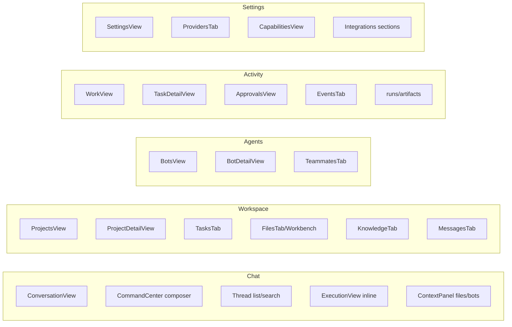

# Nerdbot — Frontend Product Experience Reorganisation Blueprint

**Status:** Proposal only. No application code modified. Awaiting review before implementation.

**Source of truth:** existing FastAPI backend at `http://localhost:8080`. All data via existing API contracts.

---

## 1. Current Frontend Route & Component Inventory

### Routes (`dashboard/src/router.ts` + `app.tsx` `parseRoute`)
| Path | View | Notes |
|---|---|---|
| `/` | Home / Chat (ConversationView, no project) | Command center + composer |
| `/work` | WorkView | Task list across projects |
| `/workbench?project=` | WorkbenchView | File editor |
| `/chat` | ConversationView (home context) | |
| `/chat/:projectId?thread=` | ConversationView (project context) | |
| `/teams`, `/team/:teamId` | TeamsView / TeamDetailView | |
| `/bot/:teammateId` | BotDetailView | |
| `/bots` | BotsView | All teammates |
| `/boards`, `/board/:boardId` | BoardsView / BoardDetailView | |
| `/projects` | ProjectsView | |
| `/p/:projectId?tab=` | ProjectDetailView | 15 tabs (now primary + Advanced) |
| `/p/:projectId/t/:taskId` | TaskDetailView | |
| `/settings` | SettingsView | |
| `/capabilities` | CapabilitiesView | |
| `/approvals` | ApprovalsView | |

### Top-level views (`dashboard/src/`)
`views-home.tsx`, `views-chat.tsx`, `views-work.tsx`, `views-workbench.tsx`, `views-teams.tsx`, `views-bot.tsx`, `views-boards.tsx`, `views-projects.tsx`, `views-settings.tsx`, `views-task.tsx`, `views-approvals.tsx`.

### Project tabs (`dashboard/src/views-project/`)
`index.tsx` (shell), `tasks.tsx`, `teammates.tsx`, `providers.tsx`, `issues.tsx`, `knowledge.tsx`, `schedules.tsx`, `approvals.tsx`, `messages.tsx`, `notifications.tsx`, `memory.tsx`, `files.tsx`, `backup.tsx`, `metrics.tsx`, `events.tsx`.

### Shared components (`dashboard/src/components.tsx`)
`StatusBadge`, `Page`, `PageHeader`, `Modal`, `Button`, `Badge`, `EmptyState`, `LoadingState`, `ErrorState`, `Field`, `useAsync`, `useTheme`, `ThemeButton`, `BotFace`, `BotChip`, `ApprovalDecisionButtons`, `ApprovalRow`, table/form style constants, `DataTable`, `Markdown`.

### API client (`dashboard/src/api.ts`)
Typed client + SSE helpers: `streamTerminal`, `streamRunEvents`, `streamChat`. Single bearer-token session.

---

## 2. Mapping Existing Features → Five Destinations



| Existing surface | → Destination |
|---|---|
| `ConversationView`, `CommandCenter`, thread list | Chat |
| `ProjectsView`, `ProjectDetailView`, `TasksTab`, `FilesTab`, `KnowledgeTab`, `MessagesTab`, `WorkbenchView` | Workspace |
| `BotsView`, `BotDetailView`, `TeammatesTab` | Agents |
| `WorkView`, `TaskDetailView`, `ApprovalsView`, `EventsTab`, runs/artifacts | Activity |
| `SettingsView`, `ProvidersTab`, `CapabilitiesView`, schedules/notifications/memory/backup/metrics | Settings (advanced) |

---

## 3. Proposed Navigation & Information Architecture

**Left sidebar (desktop):**
- Logo + "New chat" (primary CTA)
- Recent conversations (searchable)
- Divider
- **Destinations:** Chat · Workspace · Agents · Activity · Settings
- Footer: theme toggle, connection status, sign-out

**Top bar (mobile):** hamburger → drawer with the same destinations + recent chats.

**Rules:**
- Chat is always one click away; it's the default landing.
- Workspace/Agents/Activity/Settings are secondary destinations, not competing tabs.
- Advanced surfaces (boards, teams, schedules, metrics, backup, events, notifications, memory, knowledge, issues) live **inside** their destination (mostly Settings or Workspace) behind an "Advanced" disclosure — never top-level nav.
- Boards and Teams move under Workspace (advanced).

---

## 4. Proposed Layout per Destination

### Chat (primary)
- **Left:** recent threads (collapsible on mobile).
- **Center:** conversation (messages as bubbles, Markdown rendered, collapsed long output).
- **Right (desktop, optional):** activity panel — running tasks, queued, approvals-needed (collapsible).
- **Bottom:** composer — model chip, attachments, teammate mention, send/stop/retry.

### Workspace
- Project list (cards) → project detail.
- Project detail: **Chat (default)** + Tasks + Files + Knowledge + (Advanced: issues, schedules, approvals, messages, notifications, memory, backup, metrics, events).
- Deliverables/artifacts surfaced as readable files.

### Agents
- Fleet grid (cards: face, name, status, model, open tasks).
- Agent detail: profile, instructions, permissions, memory, tasks, runs, face editor.
- Create agent wizard (existing).

### Activity
- Running/queued/approval-needed list (live).
- History (completed/failed).
- Each item → task detail (with retry/cancel/open).
- Approval inbox with decision buttons.

### Settings
- Providers (model connections).
- Credentials/secrets.
- Permissions & autonomy.
- Integrations (GitHub status, webhooks).
- System config (backup, metrics, capabilities, terminal).
- Advanced (boards, teams, projects list, capabilities).

---

## 5. Chat Screen Interaction & Layout Specification

```
+---------------------------------------------------------------+
| [≡] NerdBot                              [Theme] [Account]    |
+----------+--------------------------------------+-------------+
| Sidebar  |  Conversation                        | Activity    |
|          |                                      | (optional)  |
| New chat |  ┌─ assistant bubble ─┐              | Running     |
| Search…  |  │ Markdown rendered  │              |  • task 1   |
|          |  └────────────────────┘              | Queued      |
| Recent   |  ┌─ user bubble ──────┐              |  • task 2   |
|  • hi    |  │ text               │              | Needs       |
|  • ...   |  └────────────────────┘              | approval    |
|          |                                      |  • req 1    |
| Dest:    |  (streaming preview as Markdown)     |             |
|  Chat    |                                      | [Open inbox]|
|  Worksp. |                                      |             |
|  Agents  |                                      |             |
|  Activity|                                      |             |
|  Settings|                                      |             |
+----------+--------------------------------------+-------------+
| Composer: [∞ Teammates] [Files] [+] [textarea........] [Model▾] [Send] |
| Enter to send · Shift+Enter new line · Stream ☑                            |
+---------------------------------------------------------------+
```

**Interactions:**
- Enter sends, Shift+Enter newline.
- Model chip opens picker (existing `ModelChip`).
- Attachments chip row above composer.
- Streaming preview renders Markdown live; collapses to saved message on completion.
- Long assistant replies collapse behind "Show more".
- Activity panel items click → task detail (Activity destination).
- Empty state: "What can I help you with today?" + getting-started steps until setup complete.

---

## 6. Agent Activity Panel Specification

**Location:** Right rail on Chat (desktop), collapsible drawer (mobile). Also the core of the Activity destination.

**Data source:** reuse `useWorkspaceSummary` (task/run/approval aggregation). Do NOT duplicate.

**Sections:**
1. **Running** — tasks with status `running`, show bot face + description + elapsed; click → task detail; "Cancel" action.
2. **Queued** — pending tasks awaiting execution.
3. **Needs approval** — approvals pending; inline decision buttons (approve once / approve forever / reject) with retry.
4. **Recently completed/failed** — last N, with status badge; click → task detail.

**States:** loading (skeleton), error (explicit retry, not empty), empty ("No work running. Delegate a task from chat.").

**Refresh:** poll every 3–5s while visible; pause when tab hidden.

---

## 7. Task Progress & Approval Experience

- **Task detail** (Activity) keeps existing layout: description, status, owner, latest run, output (Markdown for non-shell), artifacts, approvals, workspace files/diff, reviews, PR package, delegation tree.
- **Failures:** show one-line reason (via `explainRunError`) + Retry + Open task; raw output collapsed behind toggle (done C).
- **Approvals:** single inbox (`/approvals`) + per-task panel; three decisions; expired visible; approval executes the gated action.
- **Live progress:** SSE stream (`/runs/{id}/events/stream`) with polling fallback (existing).

---

## 8. Mobile Navigation & Responsive Behaviour

- **Sidebar** collapses to a hamburger drawer on `< md`.
- **Activity rail** becomes a bottom sheet / FAB on mobile.
- **Tab bars** scroll horizontally; advanced menu becomes a select/dropdown.
- **Composer** stacks vertically on narrow screens (existing pattern).
- **Touch targets** ≥ 44px; modals full-width on mobile.
- **No horizontal scroll** on primary content; tables scroll within containers.

---

## 9. Components Reusable Unchanged

`Markdown`, `EmptyState`, `LoadingState`, `ErrorState`, `Modal`, `Button`, `Badge`, `Field`, `StatusBadge`, `BotFace`, `BotChip`, `DataTable`, `useAsync`, `useTheme`, `ThemeButton`, `ApprovalDecisionButtons`, `ApprovalRow`, `ModelChip`, all `bot/*` avatar engine, `api.ts` client, `router.ts`, `forms.tsx`, `EntityPicker`.

---

## 10. Components Needing Modification or Consolidation

- `views-project/index.tsx` — already collapsed tabs; further: rename "Advanced" to keep, ensure Chat default (done B).
- `views-chat.tsx` `Message` — collapse long output (done A); ensure Markdown (done).
- `views-task.tsx` `ExecutionView` — failure summary + retry (done C).
- `views-home.tsx` `AttentionBanner` — keep as activity summary; ensure retry state.
- `views-bot.tsx` `BotDetailView` — empty-state CTAs (done D); consider simplifying layout.
- `app.tsx` sidebar — reorganise to 5 destinations + recent chats; move boards/teams/settings into destinations.
- `views-projects.tsx` / `views-settings.tsx` — absorb advanced surfaces.

---

## 11. Genuinely Redundant / Candidate for Removal

- `CapabilitiesView` as a top-level route → move into Settings (advanced). Keep component.
- `BoardsView`/`TeamsView` as top-level nav → move under Workspace (advanced).
- `MetricsTab`, `EventsTab`, `BackupTab`, `NotificationsTab` as primary tabs → advanced only.
- Duplicate empty-state hints that are now actionable (consolidate).
- `views-work.tsx` (WorkView) → fold into Activity destination (keep as Activity's list view).

Nothing should be deleted; surfaces are re-homed, not removed.

---

## 12. API Integration Requirements per Screen

| Screen | Key endpoints (existing) |
|---|---|
| Chat | `GET /projects`, `GET /projects/{id}/providers`, `POST /projects/{id}/threads`, `GET /threads`, `GET /threads/{id}`, `POST /threads/{id}/chat`, `POST /threads/{id}/chat/stream`, `POST /threads/{id}/summarize`, `GET /projects/{id}/workspace/files`, `GET /projects/{id}/workspace/file` |
| Workspace (projects) | `GET /projects`, `POST /projects`, `GET /projects/{id}/tasks`, `GET /projects/{id}/knowledge`, `GET /projects/{id}/messages`, `GET /projects/{id}/workspace/tree` |
| Agents | `GET /teammates`, `GET /teammates/{id}`, `PATCH`, `POST /.../disable`, `POST /.../archive`, `GET /.../tasks`, `GET /.../runs`, `GET /.../memory/tiers`, `POST /projects/{id}/teammates` |
| Activity | `GET /projects/{id}/tasks`, `GET /tasks/{id}`, `POST /tasks/{id}/runs`, `POST /tasks/{id}/runs/async`, `POST /tasks/{id}/retry`, `POST /runs/{id}/cancel`, `GET /runs/{id}/events/stream`, `GET /approvals`, `POST /approvals/{id}/decision`, `GET /projects/{id}/events` |
| Settings | `GET/POST /projects/{id}/providers`, `GET /providers/{id}/health`, `GET /providers/{id}/models`, `GET /capabilities`, `GET /projects/{id}/backup`, `POST /.../backup/import`, `GET /projects/{id}/schedules`, `GET /projects/{id}/notifications`, `GET /projects/{id}/metrics` |

No new endpoints required. All reuse existing contracts.

---

## 13. Phased Implementation Plan

### Phase 0 — Foundation (done)
- A-D UX fixes: Markdown rendering, collapse long output, chat-first tabs, empty-state CTAs. ✅ Committed in working tree.

### Phase 1 — Shell reorganisation (Low–Medium)
- **Files:** `app.tsx` (sidebar 5 destinations), `router.ts` (no change needed), new `views-activity.tsx` (rename WorkView).
- Reorganise sidebar to 5 destinations; move boards/teams/settings into destinations; keep routes working.
- **No API changes.**

### Phase 2 — Chat-first (already in progress)
- **Files:** `views-chat.tsx`, `views-home.tsx`, `views-project/index.tsx`.
- Make Chat default landing (done B); add activity rail (reuse `useWorkspaceSummary`).
- **No API changes.**

### Phase 3 — Workspace consolidation (Medium)
- **Files:** `views-projects.tsx`, `views-project/index.tsx`, `views-workbench.tsx`.
- Project detail: Chat default + Tasks + Files + Knowledge; advanced behind disclosure.
- Surface deliverables (artifacts, patches, PR packages) as readable files.

### Phase 4 — Agents destination (Medium)
- **Files:** `views-bot.tsx`, `views-project/teammates.tsx`.
- Fleet grid + agent detail; individual agent conversations (reuse ConversationView with bot context? requires backend support — currently chat is project/thread based; agent chat may need new thread type. **Open question.**).

### Phase 5 — Activity destination (Medium)
- **Files:** new `views-activity.tsx` (from `views-work.tsx` + `views-task.tsx` + `views-approvals.tsx`).
- Unified running/queued/approvals/failed/completed list + task detail.
- Live refresh + retry/cancel.

### Phase 6 — Settings consolidation (Low)
- **Files:** `views-settings.tsx`, `views-project/providers.tsx`, plus moved advanced tabs.
- Providers, credentials, permissions, integrations, system config, advanced surfaces.

### Phase 7 — Mobile & polish (Medium)
- Responsive pass: drawer nav, bottom-sheet activity, horizontal tab scroll, touch targets.
- Bundle splitting (vite manualChunks).

### Phase 8 — Verification (Low)
- Playwright E2E for 5 destinations; vitest for new components.

---

## Mermaid — Proposed Navigation

```mermaid
flowchart TD
  App[NerdBot App] --> Sidebar
  Sidebar --> Chat
  Sidebar --> Workspace
  Sidebar --> Agents
  Sidebar --> Activity
  Sidebar --> Settings
  Chat --> Threads[Recent threads]
  Chat --> Composer
  Chat --> ActivityRail[Activity rail]
  Workspace --> Projects
  Workspace --> Files
  Workspace --> Knowledge
  Workspace -.advanced.-> Boards
  Workspace -.advanced.-> Teams
  Agents --> Fleet
  Agents --> AgentDetail
  Agents --> CreateAgent
  Activity --> Running
  Activity --> Queued
  Activity --> Approvals
  Activity --> History
  Activity --> TaskDetail
  Settings --> Providers
  Settings --> Credentials
  Settings --> Permissions
  Settings --> Integrations
  Settings -.advanced.-> Schedules
  Settings -.advanced.-> Metrics
  Settings -.advanced.-> Backup
  Settings -.advanced.-> Events
  Settings -.advanced.-> Notifications
  Settings -.advanced.-> Memory
  Settings -.advanced.-> Capabilities
```



---

## Open questions / decisions needed

1. **Agent conversations:** Backend chat is project/thread based. Individual agent chat would require either (a) a thread type bound to a teammate, or (b) reusing the bot detail page's task-creation flow. Decide before Phase 4.
2. **Boards/Teams top-level vs nested:** Recommend nested under Workspace (advanced). Confirm.
3. **Approvals location:** Both Activity (inbox) and Settings (config). Keep inbox in Activity; autonomy config in Settings.
4. **Should `/work` route be renamed to `/activity`?** Recommend yes for clarity; keep `/work` as redirect for compatibility.

---

*Proposal only. No application code modified. Awaiting review before implementation.*
